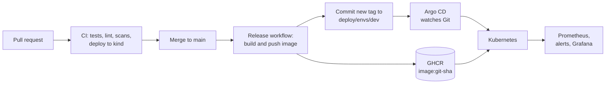

# platform-reference

[](https://github.com/aosmonkul/platform-reference/actions/workflows/ci.yml)
[](https://github.com/aosmonkul/platform-reference/actions/workflows/release.yml)

A small, complete path from a commit to a running, monitored workload on
Kubernetes. The service is trivial on purpose. The repository is about
everything around it: packaging, delivery, guard rails, observability and the
infrastructure underneath.

## How a change reaches the cluster



1. A pull request runs the full CI suite, which ends by deploying the chart to
   a throwaway [kind](https://kind.sigs.k8s.io) cluster and smoke-testing it.
2. A merge to `main` builds an image tagged with the commit SHA and pushes it
   to GHCR.
3. The same workflow commits that tag to
   [deploy/envs/dev/values.yaml](deploy/envs/dev/values.yaml).
4. Argo CD, running in the cluster, sees the commit and rolls the change out.
   CI never holds cluster credentials.

## What is in the repository

| Path | What it holds |
| --- | --- |
| [app/](app) | The `hello` service (Python, standard library plus `prometheus-client`), its tests and Dockerfile |
| [deploy/chart/](deploy/chart) | Helm chart: Deployment, Service, PodDisruptionBudget, HPA, NetworkPolicy, ServiceMonitor, alert rules, Grafana dashboard |
| [deploy/envs/](deploy/envs) | Per-environment values; the image tag here is what is deployed |
| [gitops/](gitops) | Argo CD app-of-apps: the service and `kube-prometheus-stack` |
| [infra/terraform/](infra/terraform) | VPC and EKS cluster on AWS |
| [.github/workflows/](.github/workflows) | `ci` on every pull request, `release` on merges to `main` |
| [docs/](docs) | Architecture decisions and the alert runbook |

## Run it locally

You need Docker, kind, kubectl and Helm.

```bash
make up
```

```bash
make deploy
```

```bash
make smoke
```

To hand the cluster over to Git instead, including Prometheus and Grafana:

```bash
make argocd
```

The cluster then pulls the image from GHCR. A package pushed by a workflow is
private until its visibility is changed, so either make the package public or
set `imagePullSecrets` in the chart values.

`make down` deletes the cluster.

## What CI checks

| Job | Checks |
| --- | --- |
| App | `ruff` lint and format, unit tests |
| Helm chart | `helm lint --strict`, rendered manifests validated against Kubernetes schemas with `kubeconform` |
| Terraform | `terraform fmt -check`, `terraform validate` |
| Config scan | Trivy misconfiguration scan of the Terraform, chart and Dockerfile |
| End to end | Image build, Trivy vulnerability scan, deploy to kind, smoke test, rolling restart |

Third-party actions are pinned to commit SHAs, and each workflow starts from
read-only token permissions.

## Guard rails in the chart

- Runs as a non-root user with a read-only root filesystem, no added
  capabilities, no privilege escalation and the default seccomp profile.
- No service account token is mounted; the service does not call the
  Kubernetes API.
- A NetworkPolicy denies everything except HTTP from its own, the monitoring
  and the ingress namespaces, and DNS on the way out.
- Rolling updates never drop below the requested replica count, and a
  PodDisruptionBudget keeps one pod up during node drains.
- On `SIGTERM` the app fails readiness, keeps serving for a few seconds, then
  exits, so in-flight requests are not cut off during a rollout.

## Observability

The app exports request counts and a latency histogram. Unknown paths share
one label value, so a scanner cannot inflate the number of time series.

With monitoring enabled, the chart adds a ServiceMonitor, a Grafana dashboard
and three alerts. Each alert links to a section of the
[runbook](docs/runbooks/hello.md).

| Alert | Fires when |
| --- | --- |
| `HelloDown` | No pod has been scraped successfully for 5 minutes |
| `HelloHighErrorRate` | More than 5% of requests fail for 10 minutes |
| `HelloHighLatency` | p99 latency stays above 500 ms for 10 minutes |

## AWS

[infra/terraform](infra/terraform) creates a three-zone VPC and an EKS cluster
with a managed node group. See its [README](infra/terraform/README.md) for
usage and cost.

## Design decisions

- [ADR 1: Deploy by pull (GitOps), not by push from CI](docs/adr/0001-gitops-pull-model.md)
- [ADR 2: Prove deployments on kind in CI](docs/adr/0002-kind-in-ci.md)

## Status and limits

What is exercised, and what is not:

- The app, chart and delivery pipeline run in CI on every change, including a
  real deployment to a kind cluster.
- The Argo CD and monitoring manifests are schema-checked in CI but are not
  deployed there.
- The Terraform is formatted and validated in CI. It is not planned or applied
  from this repository, which holds no AWS credentials.
- There is one environment (`dev`). Promotion to further environments would be
  a pull request that copies the tag forward.
- There is no ingress or TLS; the service is reached by port-forward.

## License

[MIT](LICENSE)
